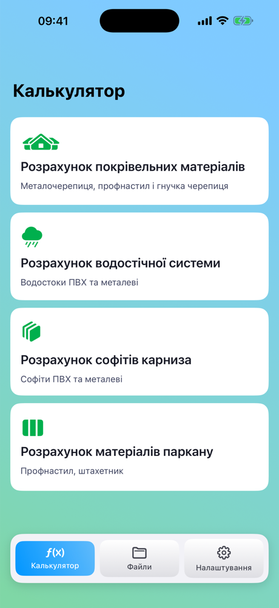
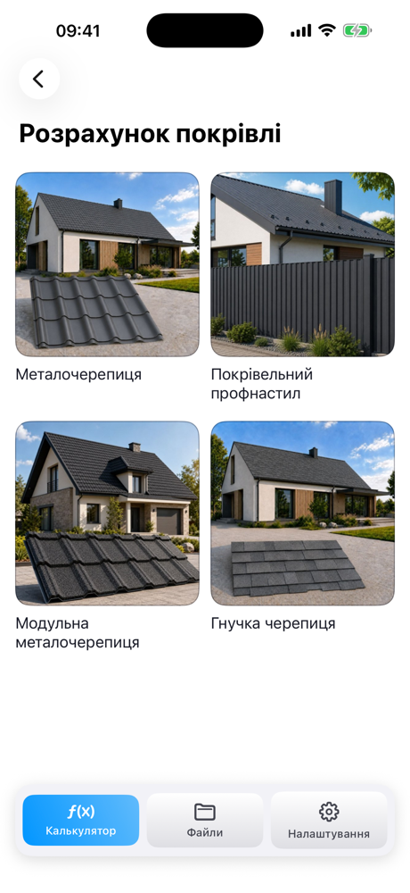
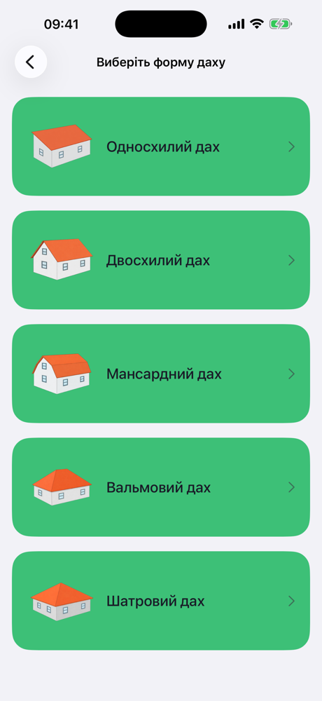
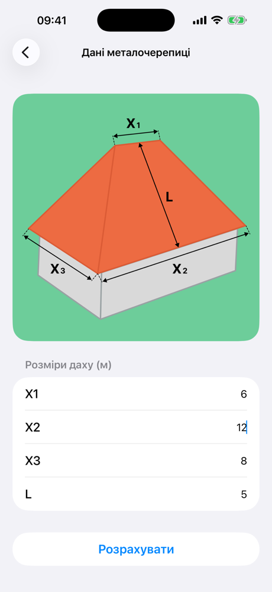
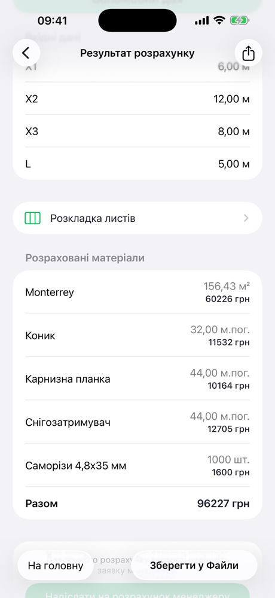
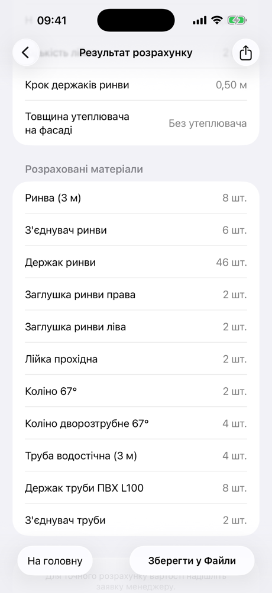
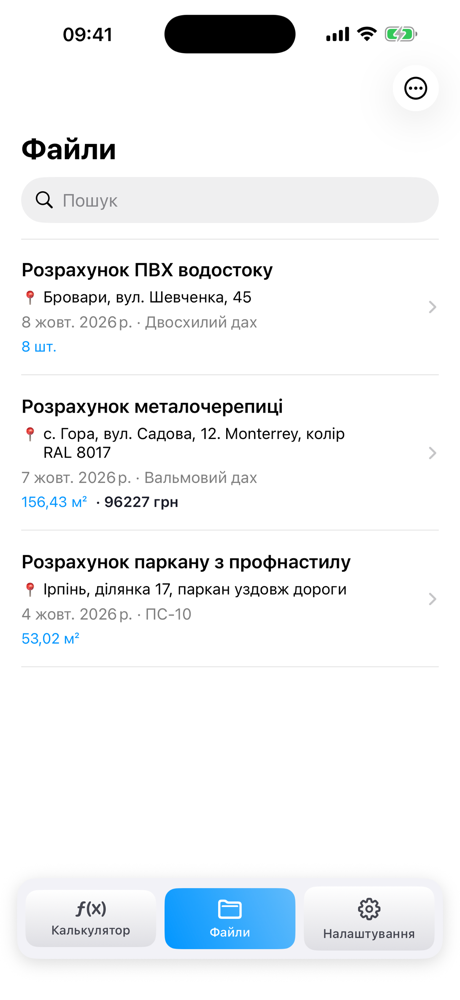

         
 
### 👋 Hi! I'm Andrii, an iOS Developer from Kyiv. Here are my commercial and personal projects.

## [VNK Calculator](https://apps.apple.com/ua/app/vnk-calculator/id6820591523)

### Commercial iOS app built to order for [VNK](https://vnk.kiev.ua/), a roofing and fencing materials supplier in Kyiv

## About app
VNK Calculator works out how much material a customer needs for a roof, a gutter system, soffits or a fence, and sends the estimate to a VNK manager in one tap for an exact quote.
I built it alone from start to finish: requirements with the client, design, development, testing with the client on TestFlight and the App Store release (October 2026). It grew out of my earlier pet project [Calculation-of-roofing-materials](https://github.com/Andruxa7/Calculation-of-roofing-materials).

- 🏠 **Roofing:** metal tile, modular metal tile, profiled sheet and bitumen shingles for five roof shapes (lean-to, gable, mansard, hip and tent), with sheet layout
- 🌧️ **Gutter systems:** six PVC and metal systems, every part worked out for the roof shape
- 🧱 **Soffits and fences:** standard or custom eaves; profiled-sheet and picket fences with a flat or arched top
- 📄 **Results:** materials list with quantities and cost, a shareable PDF, saved calculations with search and sorting
- 📨 **Lead generation:** a request to a VNK manager with the calculation attached (Mail or share sheet)
- 🌍 Ukrainian, Russian and English · iPhone and iPad · light and dark mode · no sign-up, no ads

> The source code is private (commercial project for a client).

**App screenshots:**

**Tech Used**
- 🎨 SwiftUI, MVVM, Combine
- 💾 SwiftData with a versioned schema and migration plan
- 📄 PDF generation and sharing (PDFKit, MessageUI, UIActivityViewController)
- 🌍 Localization with String Catalogs (uk / ru / en)
- 📱 Adaptive layout for iPhone and iPad, dark mode
- ✅ XCTest: 130+ unit tests for the calculation logic
- 🔒 Privacy manifest, App Privacy, App Review
- 🚀 TestFlight beta with the client, App Store release
- 🛰️ Git flow (main / develop / feature branches)

## [NewsAPI App](https://github.com/Andruxa7/NewsAPI)

### iOS App to get news from https://newsapi.org

## About app
NewsAPI app is a simple HTTP REST API for searching and retrieving live articles from all over the web.
The interface of my application consists of two screens: Top News and News by Category.
When you load the application, the first screen with the Top News opens. And on this screen, in addition to the Top News, there is a search bar. If we want to find news by some word or phrase, we just need to enter it into this search bar and press enter. And we will see the news that we requested.
And if we open the second screen called Categories, then seven categories are displayed there. When you select a category of interest, a new screen opens with news only on the topic of that category.

**App screenshots:**

**Tech Used**
- 🎨 The app designed with MVVM Architecture
- 📊 Pagination Support for data
- 🖼 UITableViewDiffableDataSource
- 🗂️ ViewModel colled with delegate

## [Rick and Morty App](https://github.com/Andruxa7/RickAndMortyApp)

### iOS App to list Rick and Morty characters
iOS Rick and Morty app enable users to browse characters and they details.

## About app
Rick and Morty app uses Api from them, recollect all characters and they details.
Also in this application there is the ability to sort characters using the SearchBar.
But for a more accurate search for characters, this application implements a method based on the UIMenu. All you need to do is just click the Sort button located in the upper right corner of the screen and select the desired sorting option from the menu that appears.
Also in this application there is an opportunity to highlight your favorite characters with a mark in the form of a heart. How to do it? Very simple, for this you need to click on the character that interests you and go to the detailed screen and click on the button in the form of a heart located in the upper right corner of the screen. When pressed, the button will change its color from gray to red, which means that this character is marked as a favorite.

**App screenshots:**

**Tech Used**
- 🎨 The app designed with VIP Clean Architecture Pattern
- ❤️‍🩹 Use SnapKit
- 📊 Pagination Support for data
- 🖼 UIComponents -> TableView, SearchBar and Menu
- 🗂️ Api call native with completion
- 💾 UserDefaults

## [Calculation-of-roofing-materials](https://github.com/Andruxa7/Calculation-of-roofing-materials)

### iOS application for calculating roofing materials and components

## About app
This application will help to make a quick calculation of roofing materials and components. It is so simple and does not require special skills in the field of roofing that this application can be easily used by both the builder and the average user. All you need to do is choose the shape of the roof that interests you and fill in the data in the cells. After all the data has been entered, the "Calculate" button will appear. After clicking on this button, there will be a transition to the next screen, where information about the parameters entered by the user and the result of the calculation with a list of required materials will be displayed.
After that, you can either return to the first screen by pressing the Home button and start a new calculation, or share the result of the calculation with someone, for example, by sending it by mail to a roofing company, or simply save it on your phone.

**App screenshots:**

**Tech Used**
- 🎨 The app designed with MVC
- ❤️‍🩹 Use Auto Layout
- 📊 UIKit
- 🖼 UIComponents -> TableView, TableViewCell
- 🗂️ FileManager
- 💾 UIActivityViewController

## [Marvel App](https://github.com/Andruxa7/MarvelApp)

### iOS App to list Marvel characters
iOS Marvel client app enable users to browse Marvel characters and they details.

## About app
Using this application, users will be able to browse through the Marvel library of characters. The data is available by connecting to the Marvel API http://developer.marvel.com.

List of Characters:
In this app present a list of characters loaded from the Marvel API character index. Notice that the when reaching the end of the list, if there are additional results to show, you can load and present the next page.

Character Details:
When selecting a character, you move to present a detail view of that character. Most of this information is already available on the result of the first API call, except for the images to be presented on the comics/series/stories/events sections.

**App screenshots:**

**Tech Used**
- 🎨 The app designed with MVC
- ❤️‍🩹 Use UIKit
- 📊 Pagination Support for data
- 🗂️ Api call native with completion

## [Pixel-Perfect-Threads-Clone-in-Swift-UI](https://github.com/Andruxa7/Pixel-Perfect-Threads-Clone-in-Swift-UI)
This is iOS app by tutorial for create an Instagram Threads clone in Swift UI and to top it off use Stream’s chat API to add real-time user-to-user messaging. 😎

https://getstream.io/blog/threads-clone-swiftui/#conclusion

**App screenshots:**

**Tech Used**
- ❤️‍🩹 Use SwiftUI
- 🖼 StreamChatSwiftUI

